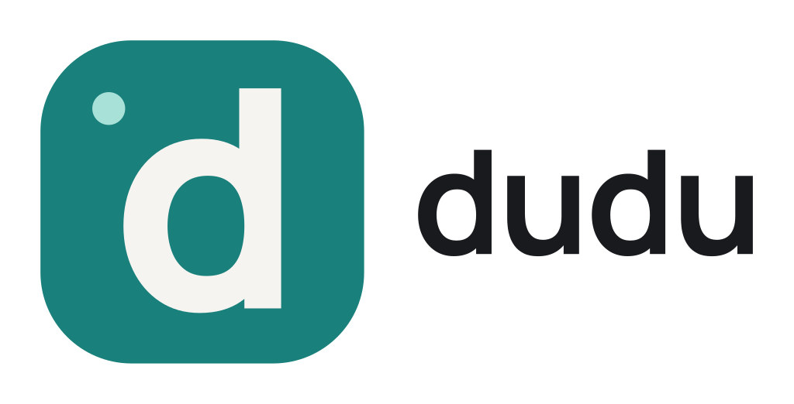
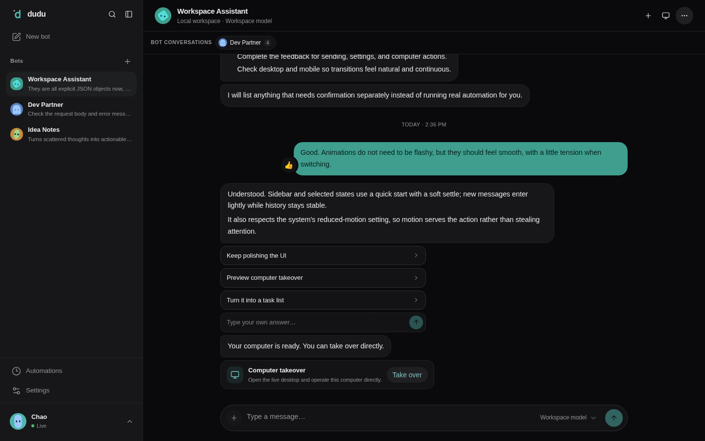
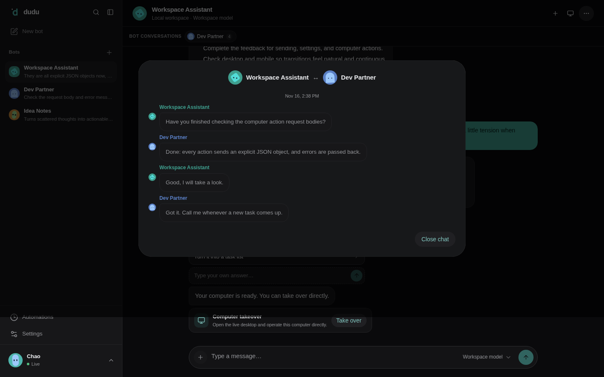

<picture>
  <source media="(prefers-color-scheme: dark)" srcset="docs/brand/png/dudu-logo-horizontal-dark-1024.png">
  
</picture>

[中文](README.md) · English


**dudu is a local-first runtime for Bots. Every Bot has a persistent identity, its own memory and workspace, and its own Linux desktop.**

dudu treats Bots as long-lived collaborators rather than one-off chat windows. A Bot can keep handling messages, scheduled work, and external events while you are away. It can start conversations, send files, collaborate with other Bots, or ask you to take over its computer.



## Features

- **Persistent identity and memory** — each Bot has its own `AGENTS.md`, `MEMORY.md`, working directory, and Pi session.
- **Proactive communication** — normal messages, questions with options, emoji reactions, file attachments (select, drop, or paste), and computer takeover requests.
- **Independent computer** — each Bot owns a desktop that is restored when dudu starts; Bots can also start, stop, and inspect it themselves. The web UI lets you watch and take over.
- **Advanced mode** — off by default. When enabled, a tool panel appears beside the Bot conversation with workspace files, a desktop terminal, a live Session view, and computer control. When off, the normal chat only keeps upload, drag, and paste attachments.
- **Bot collaboration** — Bots can inspect the workspace directory (names, purposes, live status) and message each other. The main timeline shows notices, and clicking one opens the full history.
- **Events and automation** — cron, fixed intervals, process output, and webhooks. Idle Bots receive backlog as one ordered batch.
- **Model freedom** — configure providers and models graphically, set a workspace default, and switch per conversation.
- **Shared connectors** — HTTP, command, and MCP connectors are configured once and shared by every Bot.
- **Profile** — set your nickname and avatar. Pick from random DiceBear styles and presets, or upload your own image.
- **Local data** — configuration, memory, files, and sessions all live in the workspace.

Full Bot-to-Bot history:



## Quick start

### Requirements

- [Bun](https://bun.sh/)
- Node.js 20.19+ or 22.12+ (required by Vite 8)
- For computer features: Linux X11 dependencies and [voxl](https://github.com/tembo/voxl) on `PATH`; see [operations](docs/en/operations.md)

### Install and run

```sh
bun install
bun run build
bun run start
```

Open http://127.0.0.1:7331. dudu manages Bot desktops itself, so no separate service is needed. For computer features, make sure `voxl` is on `PATH` (for example, `PATH="$HOME/.cargo/bin:$PATH" bun run start`).

Single-file distribution:

```sh
bun run build:binary
./release/dudu
```

`release/dudu` embeds the frontend and runs as a single file.

### First run

1. Go to **Settings → Models**, add a provider, API key, and models, then choose a default model.
2. Click **New Bot**, pick an avatar, and enter a name plus an optional description.
3. The Bot starts automatically and asks what you want it to work on, with clickable options.

### Advanced mode

Enable it in **Settings → Advanced** to show an independent full-height tool panel beside the Bot conversation. It opens tools in browser-like tabs, with a start page to choose one; drag the panel's left edge to adjust its width. Dragging it narrow closes the panel and keeps the tabs. The button at the left of the tab bar searches, switches, and closes open tabs; overflowing tabs fade at the edge.

The left sidebar can also be dragged; dragging it narrow collapses it into the icon rail.

- **Files** — browse `work/`, `artifacts/`, `AGENTS.md`, and `MEMORY.md`; upload, download, delete, and preview files.
- **Terminal** — open a shell in the Bot's desktop environment, starting in `work/`. Closing the panel or switching Bots only drops the browser connection; the PTY keeps running and reconnects when reopened. Only closing the terminal tab or stopping the desktop ends it.
- **Session** — inspect the Pi session history and watch text, thinking, tool calls, results, and token usage live.
- **Computer** — view and operate the current Bot desktop directly.

Closing the panel closes Session streams; terminals only detach and keep their PTY. Reopening the browser window restores the panel and tabs and reconnects terminals. When advanced mode is off, these entries and the panel stay hidden. Composer uploads, drag-and-drop, and paste stay available.

## How it works

```text
Browser (React)
      │ HTTP / SSE
      ▼
dudu server (Bun)
      ├── Store (SQLite: events / messages / bot_messages)
      ├── Scheduler ──► Pi AgentSession
      ├── Connector registry
      └── Computer / BotdSupervisor ──► Linux desktop
```

- `Store` owns the event inbox, chat timeline, Bot-to-Bot history, and run state.
- `Scheduler` delivers events to Agents in order, handles idle wakeups, and batches backlogs.
- Each Bot's Agent runs in its own Pi session.
- Desktop sessions are managed by a supervisor inside the dudu process; the live view is still proxied through the same origin.

See the [architecture document](docs/en/architecture.md) for details.

## Configuration

Common environment variables:

| Variable | Default | Description |
| --- | --- | --- |
| `DUDU_WORKSPACE` | `~/Workspace` | Workspace root |
| `DUDU_HOST` | `127.0.0.1` | API listen address |
| `DUDU_PORT` | `7331` | API port |
| `DUDU_TOKEN` | empty | Bearer token; enables authentication |

Full configuration, workspace layout, message protocol, remote access, and HTTPS deployment are documented in [docs/en/operations.md](docs/en/operations.md).

## Development

```sh
bun run dev       # frontend watch + API on one port
bun test
bun run typecheck
bun run build
bun run build:binary
bun run screenshots   # regenerate README screenshots (needs Chrome/Chromium)
```

## Documentation

- [Operations and deployment](docs/en/operations.md)
- [Architecture](docs/en/architecture.md)
- [Connectors and event protocol](docs/en/connectors.md)

Chinese: [README.md](README.md) · [中文文档](docs/operations.md)

## Contributing

Issues and pull requests are welcome.

- Run `bun test`, `bun run typecheck`, and `bun run build` before submitting.
- Keep changes focused. Update docs and tests when changing protocols or storage.
- Never commit real API keys, tokens, workspace data, or private screenshots.

## License

This project does not ship an open-source license yet; all rights are reserved by default. Choose a license before public release or external contributions.
