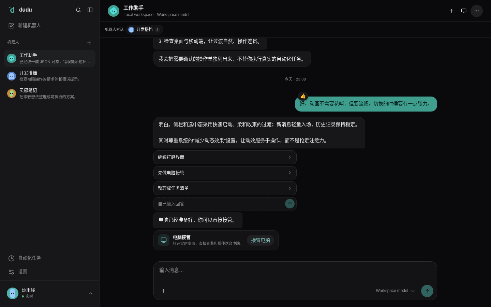
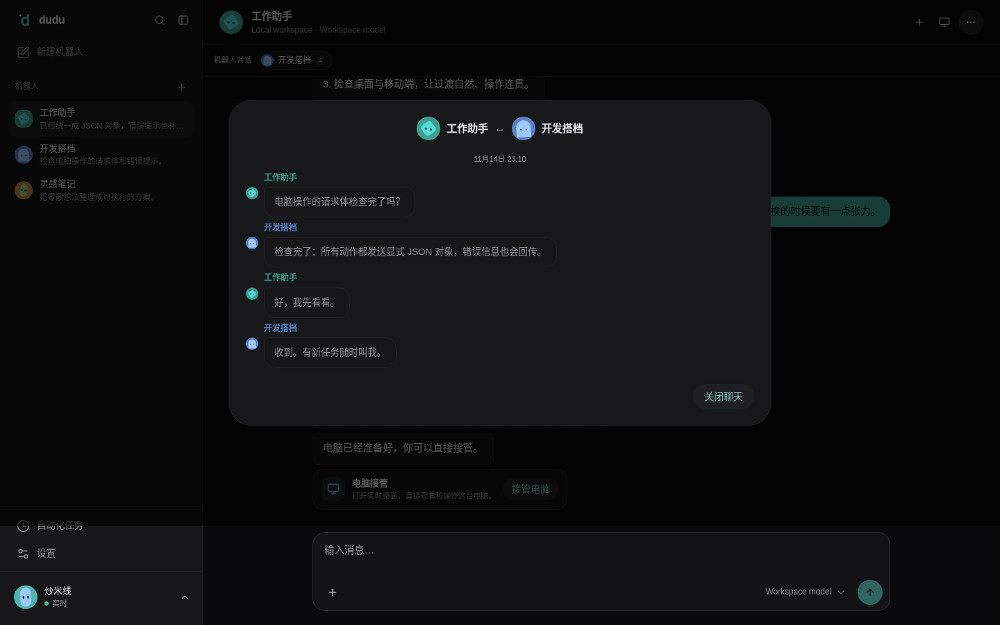

<picture>
  <source media="(prefers-color-scheme: dark)" srcset="docs/brand/png/dudu-logo-horizontal-dark-1024.png">
  
</picture>

中文 · [English](README.en.md)


**dudu 是一个本地优先的 Bot 运行时。每个 Bot 拥有持久身份、独立记忆、工作区和一台自己的 Linux 桌面。**

dudu 把 Bot 当作长期在线的协作对象，而不是一次性的聊天窗口。Bot 可以在你离开后继续处理消息、定时任务和外部事件，也可以主动与你沟通、发送文件、和其他 Bot 协作，或请求你接管它的电脑。



## 特性

- **持久身份与记忆**：每个 Bot 有独立的 `AGENTS.md`、`MEMORY.md`、工作目录和 Pi 会话。
- **主动沟通**：普通消息、带选项的提问、emoji reaction、文件附件和电脑接管请求。
- **独立电脑**：每个 Bot 有自己的桌面，默认随 dudu 启动自动恢复；Bot 也能自行启动、停止和查询桌面，网页内可查看、操作和接管。
- **Bot 协作**：Bot 可以查看工作区里的其他 Bot（名称、职责、在线状态），互发消息；主时间线显示往来提示，点击查看完整历史。
- **事件与自动化**：支持 cron、固定间隔、进程输出和 webhook；空闲时按序批量处理积压事件。
- **模型自由**：图形化配置供应商和模型，支持全局默认模型与对话内切换。
- **共享连接器**：HTTP、命令和 MCP 连接器只需配置一次，所有 Bot 共用。
- **个人资料**：设置昵称和头像；头像支持 DiceBear 多种风格与预设随机生成，也可以上传自己的图片。
- **本地数据**：配置、记忆、文件和会话均保存在工作区中。

Bot 之间的完整往来记录：



## 快速开始

### 前置条件

- [Bun](https://bun.sh/)
- Node.js 20.19+ 或 22.12+（Vite 8 构建要求）
- 电脑功能需要 Linux X11 桌面依赖和 [voxl](https://github.com/tembo/voxl)（`voxl` 需在 `PATH` 中），详见 [运行文档](docs/operations.md)

### 安装与运行

```sh
bun install
bun run build
bun run start
```

打开 http://127.0.0.1:7331。电脑桌面由 dudu 自己管理，无需单独启动服务。需要电脑功能时，确保 `voxl` 在 `PATH` 中（例如 `PATH="$HOME/.cargo/bin:$PATH" bun run start`）。

需要分发的单文件版本：

```sh
bun run build:binary
./release/dudu
```

`release/dudu` 已内嵌前端资源，单文件即可运行。

### 首次使用

1. 在 **设置 → 模型服务** 添加供应商、API key 和模型，并设置默认模型。
2. 点击 **新建机器人**，选择头像，填写名字和可选描述。
3. Bot 会自动启动，并用带选项的消息询问你想让它做什么。

## 工作原理

```text
Browser (React)
      │ HTTP / SSE
      ▼
dudu server (Bun)
      ├── Store (SQLite: events / messages / bot_messages)
      ├── Scheduler ──► Pi AgentSession
      ├── Connector registry
      └── Computer / BotdSupervisor ──► Linux desktop
```

- `Store` 负责事件收件箱、聊天时间线、Bot 间历史和运行状态。
- `Scheduler` 按顺序向 Agent 交付事件，并处理空闲唤醒与积压批量投递。
- 每个 Bot 的 Agent 运行在独立的 Pi session 中。
- 电脑会话由 dudu 进程内的 supervisor 管理；画面仍通过同源代理提供。

更完整的设计说明见 [架构文档](docs/architecture.md)。

## 配置

常用环境变量：

| 变量 | 默认值 | 说明 |
| --- | --- | --- |
| `DUDU_WORKSPACE` | `~/Workspace` | 工作区根目录 |
| `DUDU_HOST` | `127.0.0.1` | API 监听地址 |
| `DUDU_PORT` | `7331` | API 端口 |
| `DUDU_TOKEN` | 空 | Bearer token，启用鉴权 |

完整配置、工作区结构、消息协议、远程访问和 HTTPS 部署见 [docs/operations.md](docs/operations.md)。

## 开发

```sh
bun run dev       # 前端 watch + API，同一端口
bun test
bun run typecheck
bun run build
bun run build:binary
bun run screenshots   # 重新生成 README 截图（需要 Chrome/Chromium）
```

## 文档

- [运行与部署](docs/operations.md)
- [架构](docs/architecture.md)
- [连接器与事件协议](docs/connectors.md)

英文版：[README.en.md](README.en.md) · [English docs](docs/en/operations.md)

## 贡献

欢迎提交 issue 和 pull request。

- 提交前请运行 `bun test`、`bun run typecheck` 和 `bun run build`。
- 保持改动聚焦；涉及协议或存储结构时，请同步更新文档和测试。
- 不要提交真实 API key、token、工作区数据或私人截图。

## 许可证

本项目目前未添加开源许可证，默认保留所有权利。在公开发布或接受外部贡献前，需要先确定许可证。
