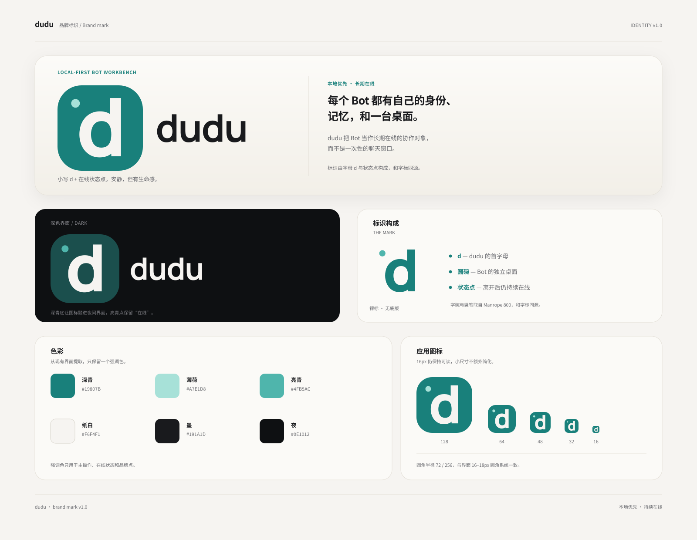

# dudu 品牌标识

## 概念

**小写 d + 在线状态点。** d 是字标的首字母；圆碗代表 Bot 的独立工作区；点代表持续在线。刻意避开机器人、天线和聊天气泡等常见 Bot 符号。

## 文件

| 文件 | 用途 |
| --- | --- |
| `dudu-app-icon.svg` / `-dark` | 应用图标，浅色 / 深色背景 |
| `dudu-mark.svg` / `-dark` / `-mono` | 裸标；mono 版本继承 `currentColor` |
| `dudu-wordmark.svg` / `-dark` / `-mono` | 字标 |
| `dudu-logo-horizontal.svg` / `-dark` / `-mono` | 横向组合 |
| `dudu-logo-stacked.svg` / `-dark` | 纵向组合 |
| `favicon.svg` / `favicon.ico` | 站点图标；SVG 跟随系统深浅色 |
| `dudu-brand-board.svg` / `.png` | 品牌预览板 |
| `png/` | 16–1024px 常用尺寸 |

所有 SVG 都是路径轮廓，不依赖本机字体。

## 使用规则

- 最小尺寸：应用图标 16px，裸标 24px，横向组合 120px 宽，纵向组合 96px 宽。
- 四周留白至少为图标高度的 1/4。
- 浅色背景用浅色版，深色背景用深色版；单色印刷用 `*-mono`。
- 不要拉伸、旋转、加阴影/描边/渐变，也不要把状态点分离或改成通知红点。
- 不要用其他字体重排“dudu”，直接使用字标文件。

## 色彩

| 名称 | 色值 | 用途 |
| --- | --- | --- |
| 深青 Deep Teal | `#19807B` | 主色、浅色图标底 |
| 薄荷 Mint | `#A7E1D8` | 浅色图标状态点 |
| 亮青 Bright Teal | `#4FB5AC` | 深色状态点、强调 |
| 纸白 Paper | `#F6F4F1` | 浅色图标上的 d |
| 墨 Ink | `#191A1D` | 浅色字标 |
| 夜 Night | `#0E1012` | 深色界面底 |
| 深青底 Deep Teal Tile | `#1B4F4D` | 深色图标底 |

品牌只保留青绿一个强调方向；Bot 头像的彩色属于产品内容，不属于标识。

## 字体

字标为 **Manrope 700**，图标内的 d 为 **Manrope 800**，均已转为轮廓。Manrope 使用 SIL Open Font License 1.1。

## 应用接入

1. `public/brand/` 提供 favicon 与裸标，`index.html` 引用 favicon。
2. 侧栏品牌位：`dudu-mark.svg` / `-dark`，24px，旁边保留“dudu”文字。
3. 欢迎页：裸标 56px。
4. README 顶部：`png/dudu-logo-horizontal-1024.png`，深色模式切换 `-dark` 版本。
5. 文档截图由 `bun run screenshots` 统一生成。
